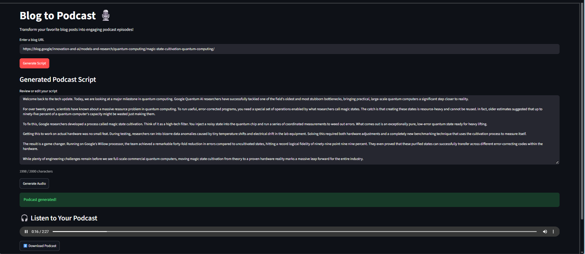

# 📰 ➡️ 🎙️ AI Blog to Podcast

Turn blog articles into engaging, AI-generated podcasts in just a few clicks!

**AI Blog to Podcast** is a Streamlit-based web application that transforms blog posts into natural-sounding podcast episodes using **Google Gemini, Firecrawl, and ElevenLabs**.

Simply provide a blog URL, and the application extracts the article, generates a conversational podcast script, and converts it into speech. Users can review and edit the script before generating audio, listen directly in the browser, or download the podcast as an MP3.

## 🎧 Sample Podcast

[▶️ Listen to a sample podcast](assets/sample-podcast.mp3)

*Generated from [Bringing the magic: Google breaks open a bottleneck in quantum computing](https://blog.google/innovation-and-ai/models-and-research/quantum-computing/magic-state-cultivation-quantum-computing/), published on the Google Blog.*

## 📸 Application Preview

<p align="center">
  
</p>

<p align="center">
  <em>AI Blog to Podcast — Generate, edit, listen to, and download AI-powered podcasts.</em>
</p>

## ✨ Features

- **📰 Blog Scraping:** Extracts article content from public blog URLs using the Firecrawl API.
- **🧹 Content Cleaning:** Removes Markdown formatting, unnecessary links, images, and promotional content using Python regex.
- **🤖 AI Script Generation:** Uses Google Gemini to transform articles into engaging, conversational podcast narrations within a 2,000-character limit.
- **✏️ Script Preview & Editing:** Allows users to review and modify the generated script before converting it into audio.
- **🎙️ Text-to-Speech:** Generates natural-sounding podcast audio using ElevenLabs Flash v2.5.
- **🎧 Built-in Audio Player:** Listen to generated podcasts directly on the website.
- **⬇️ MP3 Download:** Download generated podcasts for offline listening.
- **🛡️ Error Handling & Validation:** Handles invalid URLs, missing article content, incomplete scripts, and API failures.

## 🛠️ Tech Stack

| Technology | Purpose |
|---|---|
| Python | Core application logic |
| Streamlit | Interactive web interface |
| Firecrawl | Web scraping and article extraction |
| Google Gemini | AI-powered podcast script generation |
| ElevenLabs | Text-to-speech audio generation |
| Python Regex | Markdown cleaning and text preprocessing |
| python-dotenv | Environment variable management |

## ⚙️ How It Works

```text
          Blog URL
             |
             v
     Firecrawl API
      (Web Scraping)
             |
             v
     Content Cleaning
      (Python Regex)
             |
             v
       Google Gemini
    (Script Generation)
             |
             v
     Script Validation
             |
             v
     Review / Edit Script
             |
             v
      ElevenLabs API
      (Text-to-Speech)
             |
             v
       Podcast Audio
             |
        +----+----+
        |         |
        v         v
      Listen    Download
      Online      MP3
```

## 🚀 Getting Started

### Prerequisites

Before running the application, make sure you have:

- Python 3.10 or higher
- A [Firecrawl](https://www.firecrawl.dev/) API key
- A [Google Gemini](https://aistudio.google.com/apikey) API key
- An [ElevenLabs](https://elevenlabs.io/) API key

### Installation

**1. Clone the repository**

```bash
git clone https://github.com/adityabasu-dev/AI-blog-to-podcast.git
cd AI-blog-to-podcast
```

**2. Create a virtual environment**

```bash
python -m venv .venv
```

Activate it:

Windows:

```bash
.venv\Scripts\activate
```

macOS/Linux:

```bash
source .venv/bin/activate
```

**3. Install dependencies**

```bash
pip install -r requirements.txt
```

**4. Configure environment variables**

Copy the example environment file to create your own `.env`:

macOS/Linux:

```bash
cp .env.example .env
```

Windows:

```bash
copy .env.example .env
```

Then open `.env` and replace the placeholders with your real API keys:

```env
FIRECRAWL_API_KEY=your_firecrawl_api_key
GEMINI_API_KEY=your_gemini_api_key
ELEVENLABS_API_KEY=your_elevenlabs_api_key
```

**Important:** Never commit your `.env` file or expose API keys publicly.

**5. Run the application**

```bash
streamlit run app.py
```

Streamlit will display a local URL, typically:

```text
http://localhost:8501
```

## 🎯 Usage

1. **Enter a Blog URL:** Paste the URL of a publicly accessible article.
2. **Generate Script:** Click the Generate Script button to extract and process the article using Gemini.
3. **Review & Edit:** Preview the generated narration and make any necessary changes.
4. **Generate Audio:** Convert the validated script into speech using ElevenLabs.
5. **Listen or Download:** Play the generated podcast directly in your browser or download the MP3.

## 📁 Project Structure

```text
AI-blog-to-podcast/
├── app.py
├── pipeline.py
├── requirements.txt
├── .env.example
├── .env
├── .gitignore
└── README.md
```

- `app.py` — Streamlit frontend and user interactions.
- `pipeline.py` — Article scraping, preprocessing, script generation, validation, and text-to-speech functions.
- `requirements.txt` — Python dependencies.
- `.env.example` — Template listing the required environment variables (placeholders only).
- `.env` — Local API credentials (created by you, not committed).
- `.gitignore` — Files excluded from version control.
- `README.md` — Project documentation.

## ⚠️ Limitations

- Works best with publicly accessible, text-based blog articles.
- Login-protected pages or websites that block scraping may not work.
- Podcast scripts are currently limited to 2,000 characters.
- AI-generated narration may occasionally contain inaccuracies.
- Audio generation depends on available ElevenLabs API credits.
- Very long articles may be rejected to avoid excessive processing.

## 🔮 Future Improvements

- Multiple voice options and voice customization
- Multi-speaker podcast conversations
- Support for multiple languages
- Longer podcast episodes
- Podcast history and saved episodes
- Improved script generation and summarization controls
- Cloud deployment for public access